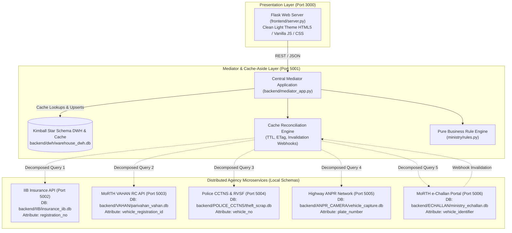

# Distributed System Architecture: VahanRakshak

## 1. Multi-Tier Distributed Architecture

## 2. Layers

1. **Distributed Source Layer** — Five independent agency microservices (`backend/*/`), each running on its own designated port with its own SQLite database file. No cross-database joins or shared foreign keys exist.
2. **Central Mediator Layer** (`backend/mediator_app.py`, Port 5001) — The Global Schema Coordinator. Accepts high-level queries, decomposes them into 5 source-specific HTTP calls with translated attribute names, and integrates the results into a conformed vehicle dossier.
3. **Cache-Aside & Stale Data Reconciliation Layer**:
   - **Cache HIT**: Serves cached records from the warehouse in `<2ms`.
   - **TTL Expiry**: 300-second time-to-live triggers background re-synchronization.
   - **Webhook Invalidation**: Updates on an agency (e.g. e-Challan status) post an automated invalidation webhook to purge stale cache.
   - **⚡ Force Live Sync**: Bypasses cache on demand for real-time demonstration.
4. **Rule Engine** (`ministry/rules.py`) — Pure functions computing insurance validity, suspicion flags, risk level (LOW, MEDIUM, HIGH, CRITICAL), and statutory violation triggers.
5. **Analytical Warehouse Layer** (`backend/dwh/warehouse_dwh.db`) — Star schema (`FACT_VEHICLE_EVENT`, `DIM_VEHICLE`, `DIM_LOCATION`, `DIM_DATE`, `DIM_STATUS`) with materialized views (`mv_vehicle_complete_history`) supporting server-side SQL pagination (`LIMIT ? OFFSET ?`).
6. **Presentation Layer** (`frontend/server.py`, Port 3000) — Standalone Flask web server rendering a crisp, professional Light Theme dashboard accessible from any device on the local network (`http://192.168.52.85:3000`).

## 3. Real-World Digital Infrastructure Mapping

- **IRDAI IIB**: Mimics the central Insurance Information Bureau of India.
- **MoRTH VAHAN**: Mimics the National Vehicle Registry accessed via API Setu / NIC.
- **Police CCTNS & RVSF**: Mimics the Crime & Criminal Tracking Network for stolen vehicles and Registered Vehicle Scrapping Facilities.
- **Highway ANPR**: Mimics automated toll plaza cameras (Fastag / ANPR).
- **MoRTH e-Challan**: Mimics `echallan.parivahan.gov.in` for Section 196 enforcement.
