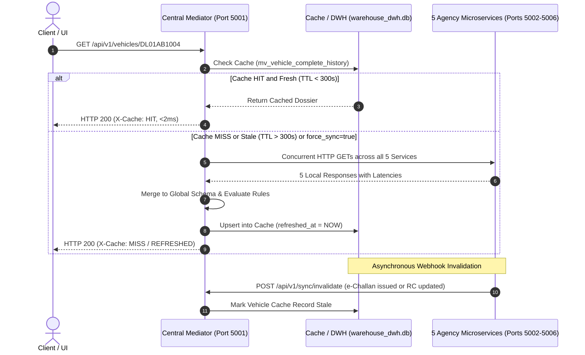

# Federation, Query Decomposition, and Cache Reconciliation

## 1. The Distributed Federation Pattern

In this architecture, federation operates at both the **HTTP Microservice layer** and the **SQL Decomposition layer**:

1. **Identifier Normalization**:
   `backend/mediator_app.py` normalizes raw input (removing whitespace and hyphens, converting to uppercase) into the canonical vehicle key (e.g. `DL01AB1004`).
2. **Query Decomposition (1 Request ➔ 5 Microservice Calls)**:
   The Mediator simultaneously dispatches 5 concurrent HTTP REST calls to the independent agency microservices:
   - `GET http://127.0.0.1:5002/api/v1/policies/<plate>` (IIB: uses `registration_no`)
   - `GET http://127.0.0.1:5003/api/v1/rc/<plate>` (VAHAN: uses `vehicle_registration_id`)
   - `GET http://127.0.0.1:5004/api/v1/records/<plate>` (Police CCTNS: uses `vehicle_no`)
   - `GET http://127.0.0.1:5005/api/v1/captures/<plate>` (Highway ANPR: uses `plate_number`)
   - `GET http://127.0.0.1:5006/api/v1/challans/<plate>` (e-Challan: uses `vehicle_identifier`)
3. **Fault Tolerance**:
   Calls are executed via a `ThreadPoolExecutor` with strict timeouts. If an agency service is offline or errors, the Mediator gracefully degrades, returning partial data and flagging the offline source without crashing the global inquiry.
4. **Global Schema Aggregation**:
   The Mediator translates the 5 local JSON responses into the Conformed Global Vehicle Model, executing the pure business rules (`ministry/rules.py`) to derive insurance validity, suspicion flags, and risk levels.

---

## 2. Cache-Aside & Stale Data Reconciliation Protocol

To solve the dual challenges of **eliminating slow repetitive API calls** while **preventing stale cache reads**:

---

## 3. Transparency & Evaluator Inspection

The frontend's **Vehicle Inspector** tab provides complete transparency:
- Displays whether the response was a **Cache Hit (&lt;2ms)** or **Live 5-API Federation**.
- Includes the **Live Federated Query Visualizer**, displaying all 5 agency cards with their local attribute keys, target URLs, response times in milliseconds, and raw JSON payloads.
- Includes a **"⚡ Force Live Sync"** button, allowing evaluators to bypass cache on demand and watch all 5 microservices respond in real time.
